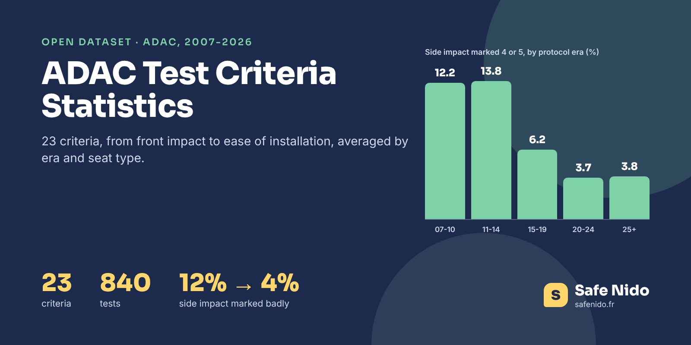

# ADAC Child Car Seat Test Criteria Statistics



[](https://doi.org/10.5281/zenodo.24167196) [](https://www.kaggle.com/datasets/safenido/adac-child-car-seat-test-criteria-statistics) [](https://huggingface.co/datasets/safenido/adac-child-seat-criteria-statistics) [](https://creativecommons.org/licenses/by/4.0/) [](https://www.safenido.fr/)

**English first, version française plus bas.**

Behind every ADAC grade there are about twenty marks, from the front and side impact to how easy the seat is to install, how much room it takes in the car and how much room it leaves the child. This dataset gives the **average of each of the 23 criteria, by protocol era and by seat type**, over the 840 tests published since 2007, with the share of seats marked well and the share marked badly.

It answers questions parents ask all the time, such as which seats are the easiest to install, or whether seats really got safer on the side impact.

### The Headline Numbers

|  |  |
|---|---|
| Criteria | 23 |
| Tests behind the averages | 840 |
| Side impact marked badly, 2007-2010 | 12.2% |
| Side impact marked badly, 2020-2024 | 3.7% |
| Installation marked badly, 2011-2014 | 29.4% |
| Installation marked badly, 2020-2024 | 3.7% |
| Easiest to install, 2020-2024 | High-back boosters, then infant carriers |

Marks go from 1 (very good) to 5 (poor). Seats did get better where it matters. On the side impact, the share of seats marked 4 or 5 fell from 12% in 2007-2010 to under 4% in 2020-2024, and installation went from almost one seat in three marked badly to fewer than one in twenty. One thing got worse, the room seats take in the car. Under the 2025 protocol three seats in four are marked badly on it.

### Files

| file | content |
|---|---|
| `data/adac_criteria_by_era_and_seat_type.csv` | 730 rows, one per criterion, protocol era and seat type (seat_type all for every seat) |
| `images/cover.png` | Cover image, 1600 × 800 |

### Columns

**adac_criteria_by_era_and_seat_type.csv**

| column | description |
|---|---|
| `criterion` | Criterion code |
| `criterion_en, criterion_fr` | Criterion name in English and French |
| `adac_part` | Part of the ADAC grade it belongs to, safety, handling, ergonomics or pollutants |
| `protocol_era` | ADAC protocol era |
| `seat_type` | Seat type, or all |
| `tests` | Tests with a mark for this criterion |
| `mean_mark` | Average mark, 1 best to 5 worst |
| `share_mark_1_or_2_pct` | Share of seats marked 1 or 2 |
| `share_mark_4_or_5_pct` | Share of seats marked 4 or 5 |

### Load It

```python
import pandas as pd

base = "https://raw.githubusercontent.com/safenido/adac-child-seat-criteria-statistics/main"
df = pd.read_csv(f"{base}/data/adac_criteria_by_era_and_seat_type.csv")
df[(df.seat_type == "all")].pivot(index="criterion_en", columns="protocol_era", values="mean_mark")
```

### How It Was Built

Built from the criterion marks recorded for each published ADAC test in the Safe Nido database. Groups with fewer than 3 tests are left out. Seat types follow Safe Nido's own classification.

### Checked Against The Source

Every criterion was checked to stay within the 1 to 5 scale, and the number of tests per era matches the companion test protocols dataset.

### Read With Care

- **Criteria change with the protocol.** Some exist only in some eras (PFAS since 2025, head side protection before 2015).
- **Small groups move a lot**, check the tests column.
- **Averages only**, no individual result is published.

### License And Citation

**[CC BY 4.0](https://creativecommons.org/licenses/by/4.0/)**. Use it, share it and adapt it, commercially or not, and credit **Safe Nido** with a link to **[safenido.fr](https://www.safenido.fr/)**, along with the original source below.

```bibtex
@misc{safenido_adac_child_seat_criteria_statistics_2026,
  title  = {ADAC Child Car Seat Test Criteria Statistics},
  author = {{Safe Nido}},
  year   = {2026},
  doi    = {10.5281/zenodo.24167196},
  url    = {https://github.com/safenido/adac-child-seat-criteria-statistics},
  note   = {Dataset, version 1.0}
}
```

Source. Published results of the ADAC and ÖAMTC child seat tests, aggregated by Safe Nido, https://www.safenido.fr/test-adac/comment-lire-note-adac/

Archived on **[Zenodo](https://doi.org/10.5281/zenodo.24167196)** with a permanent DOI, 10.5281/zenodo.24167196.

Companion datasets, **[ADAC Child Car Seat Test Protocols 2007-2026](https://github.com/safenido/adac-child-seat-test-protocols)** ([Kaggle](https://www.kaggle.com/datasets/safenido/adac-child-car-seat-test-protocols-2007-2026), [Hugging Face](https://huggingface.co/datasets/safenido/adac-child-seat-test-protocols)), **[Child Car Seat Crash Test Statistics 2007-2026](https://github.com/safenido/child-car-seat-crash-test-statistics)** ([Kaggle](https://www.kaggle.com/datasets/safenido/child-car-seat-crash-test-statistics-2007-2026), [Hugging Face](https://huggingface.co/datasets/safenido/child-car-seat-crash-test-statistics)). All Safe Nido datasets are listed in **[Child Passenger Safety Datasets](https://github.com/safenido/child-passenger-safety-datasets)**.

Also on **[GitHub](https://github.com/safenido/adac-child-seat-criteria-statistics)**, **[Kaggle](https://www.kaggle.com/datasets/safenido/adac-child-car-seat-test-criteria-statistics)** with a starter notebook, and **[Hugging Face](https://huggingface.co/datasets/safenido/adac-child-seat-criteria-statistics)**, ready for the `datasets` library.

### On Safe Nido

The data behind these files is used on [Safe Nido](https://www.safenido.fr/), an independent French guide to child car seats built on twenty years of crash tests.

- [How to read an ADAC grade](https://www.safenido.fr/test-adac/comment-lire-note-adac/)
- [Our index explained](https://www.safenido.fr/notre-indice/)
- [Every ADAC result](https://www.safenido.fr/test-adac/)

---

## Version Française

### Les Critères Des Tests ADAC En Moyenne

Les 23 critères des tests ADAC, du choc frontal à la facilité d'installation, en moyenne par époque de protocole et par type de siège, sur 840 tests. Les sièges marqués mal au choc latéral sont passés de 12 % en 2007-2010 à moins de 4 % en 2020-2024.

Licence CC BY 4.0, en citant **Safe Nido** et un lien vers **[safenido.fr](https://www.safenido.fr/)**. Retrouvez les guides et les fiches des sièges sur [Safe Nido](https://www.safenido.fr/).
